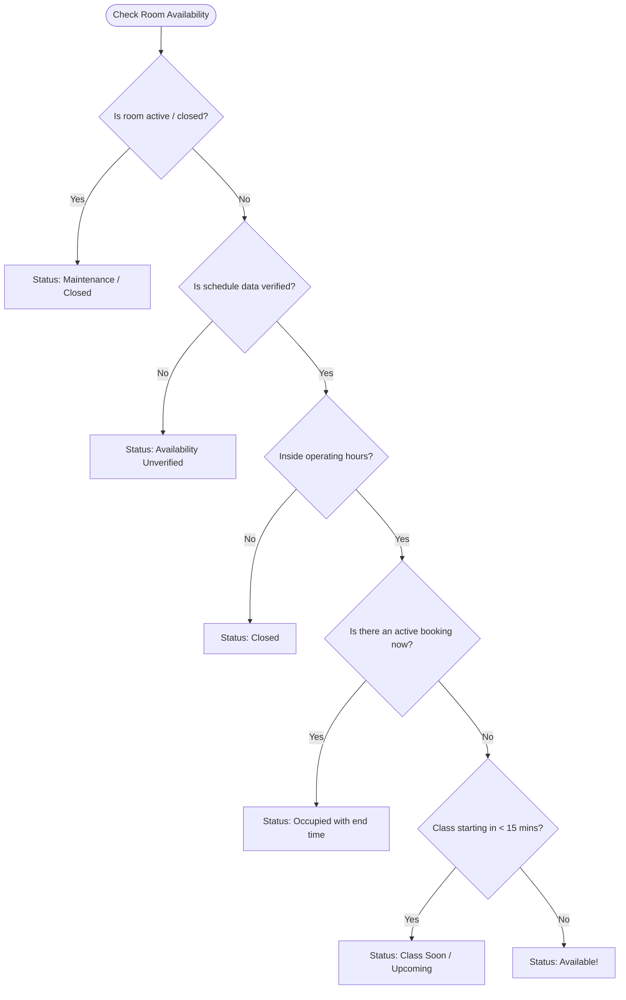

# 🎓 University Room Checker

[](https://nextjs.org/)
[](https://www.typescriptlang.org/)
[](https://tailwindcss.com/)
[](https://vitest.dev/)
[](./LICENSE)

> A modern, responsive web application built to help university students, faculty members, and campus visitors easily check real-time classroom availability, find faculty offices, and locate campus facilities without walking around asking people.

---

## 📖 Table of Contents

- [💡 Why I Built This](#-why-i-built-this)
- [✨ Key Features](#-key-features)
- [🧠 How the Availability Logic Works](#-how-the-availability-logic-works)
- [🛠️ Tech Stack](#️-tech-stack)
- [📁 Project Structure](#-project-structure)
- [🚀 Getting Started (Step-by-Step)](#-getting-started-step-by-step)
- [🔑 Demo Credentials](#-demo-credentials)
- [🧪 Running the Tests](#-running-the-tests)
- [🗄️ Database Integration (Optional)](#️-database-integration-optional)
- [🎓 What I Learned Building This](#-what-i-learned-building-this)
- [🤝 Contributing](#-contributing)
- [📄 License](#-license)

---

## 💡 Why I Built This

As a university student, one of the most frustrating daily struggles is finding a free room to study in with friends between classes, or trying to find a professor's office when their door is locked. Often, you end up wandering through different buildings and floors asking strangers.

I built this project to solve that exact problem! It creates a single, centralized digital dashboard for the campus where anyone can:
- Instantly see which classrooms are **free right now**.
- Look up class schedules across the university's 5-day week (**Sunday to Thursday**).
- Find **teacher offices**, **department heads**, the **Dean's office**, and **Chairman's room**.
- Explore student facilities like **computer labs**, **libraries**, **seminar halls**, and **prayer rooms**.
- Allow authorized university admins to manage rooms, bookings, and temporary maintenance closures.

---

## ✨ Key Features

### 1. 🔍 Instant Room Finder & Smart Search
- Search by **room number** (e.g. `302`), **name** (e.g. `Computer Lab`), **professor name** (e.g. `Dr. Ahmed`), **building**, or **department**.
- Toggle between a responsive **Card Grid** and a compact **List View**.
- Filter by Building, Floor, Room Category, and Real-Time Status.

### 2. 📅 5-Day Academic Week Support
- Built around standard university schedules: **Sunday, Monday, Tuesday, Wednesday, and Thursday**.
- Automatically detects the current day and time based on campus timezone (`Asia/Dhaka`).
- Interactive daily timetable showing when rooms are booked and when they are free.

### 3. 🚦 Clear Visual Status Indicators
Every room card clearly shows its state:
- 🟢 **Available**: The room is open and free to use right now.
- 🔴 **Occupied**: A class is currently taking place (shows the course name and when it ends).
- 🟡 **Class Soon**: A class is starting within the next 15 minutes.
- ⚪ **Closed**: The room is outside its normal operating hours (e.g. early morning or night).
- 🟠 **Maintenance**: Temporarily closed for renovations or repairs.
- 🔘 **Availability Unverified**: Explicitly displayed when schedule data is incomplete. *The system never fakes availability!*

### 4. 👨‍🏫 Faculty & Office Directory
- Comprehensive faculty directory categorized by Leadership (Deans, Chairmen) and faculty members.
- Shows assigned office rooms, office hours by day, and teaching timetables.
- Direct link from faculty profile to their office room page.

### 5. 🏢 Campus Facilities Directory
- Dedicated section for Libraries, Computer Labs, Physics/Science Labs, Seminar Halls, Common Rooms, and Prayer Rooms.
- Shows opening hours, capacity, amenities (AC, WiFi, Projectors), and room directions.

### 6. 🛡️ Administrator Management Dashboard
- **Protected by Authentication**: Unauthorized users cannot access admin pages.
- **Room Management**: Add new rooms, edit information, toggle maintenance mode.
- **Schedule Management**: Create recurring weekly classes or specific date bookings.
- **Conflict Engine**: Automatically alerts admins if two bookings overlap or clash on buffer time.
- **CSV Import & Export**: Export data to spreadsheets or import existing university CSV records with line-by-line error checking.
- **Audit History**: Keeps a log of who made which changes and when.

---

## 🧠 How the Availability Logic Works

Instead of using hardcoded statuses or random placeholders, this application calculates room availability deterministically using pure mathematical functions (`lib/availability.ts`):



---

## 🛠️ Tech Stack

- **Framework**: [Next.js 14](https://nextjs.org/) (App Router with React Server & Client Components)
- **Language**: [TypeScript](https://www.typescriptlang.org/) (Strict type safety across the entire app)
- **Styling**: [Tailwind CSS](https://tailwindcss.com/) with custom design tokens for academic styling
- **UI Icons**: [Lucide React](https://lucide.dev/)
- **State Management**: [Zustand](https://github.com/pmndrs/zustand) with local storage persistence
- **Testing**: [Vitest](https://vitest.dev/) with React Testing Library
- **Database (Optional)**: [Supabase](https://supabase.com/) / PostgreSQL with Row-Level Security (RLS)

---

## 📁 Project Structure

Here is how the project files are organized:

```text
university-room-checker/
├── app/                        # Next.js App Router pages
│   ├── page.tsx                # Home / Dashboard
│   ├── layout.tsx              # Root layout & providers
│   ├── globals.css             # Tailwind styles & theme variables
│   ├── login/                  # Authentication page
│   ├── rooms/                  # Room checker & details (/rooms/[id])
│   ├── faculty/                # Faculty directory & profile (/faculty/[id])
│   ├── facilities/             # Campus facilities directory
│   └── admin/                  # Protected admin suite (rooms, schedules, conflicts, audit, settings)
├── components/                 # Reusable UI components
│   ├── layout/                 # Navbar & footer
│   ├── rooms/                  # Room cards, timetable, search bar, status badges
│   ├── admin/                  # ProtectedRoute component
│   └── ui/                     # Accessible buttons, dialogs, inputs, toasts
├── lib/                        # Business logic & utilities
│   ├── availability.ts         # Pure availability calculation engine & timetable builder
│   ├── demo-data.ts            # Realistic demonstration university data
│   ├── search.ts               # Text search & intent filtering
│   ├── store.ts                # Zustand global store & actions
│   └── utils.ts                # Date, time, and CSV helper functions
├── supabase/
│   └── schema.sql              # PostgreSQL schema with constraints, indexes & RLS policies
├── tests/                      # Automated unit test suite
│   ├── availability.test.ts    # 16 tests for all room status edge cases
│   └── search.test.ts          # 9 tests for search and CSV parsing
├── package.json
├── tsconfig.json
└── tailwind.config.ts
```

---

## 🚀 Getting Started (Step-by-Step)

Follow these steps to run the project on your local machine:

### 1. Clone the repository
```bash
git clone https://github.com/your-username/university-room-checker.git
cd university-room-checker
```

### 2. Install dependencies
Make sure you have [Node.js](https://nodejs.org/) installed (version 18 or newer).
```bash
npm install
```

### 3. Run the development server
```bash
npm run dev
```

### 4. Open in your browser
Open your favorite browser and visit:
👉 **[http://localhost:3000](http://localhost:3000)**

That's it! The application comes pre-loaded with realistic demo data, so everything works out of the box without needing any database setup.

---

## 🔑 Demo Credentials

You can test the role-based functionality using these accounts (or use the one-click buttons on the `/login` page):

| Role | Email | Password | What You Can Access |
|---|---|---|---|
| **Administrator** | `admin@gfu.edu` | `admin123` | Full access to the protected `/admin` portal, room editing, schedule management, conflict checks, and CSV tools |
| **Student / Visitor** | `student@gfu.edu` | `student123` | Public room search, schedule viewing, faculty directory, and campus facilities |

---

## 🧪 Running the Tests

To make sure the availability calculations and search filters are working reliably, 25 unit tests were written using **Vitest**:

```bash
# Run tests once
npm test

# Run tests in watch mode
npm run test:watch
```

All 25 tests verify important edge cases including:
- Room status before, during, and after scheduled classes
- Buffer time calculations between consecutive classes
- Early morning / late night operating hours
- Handling cancelled classes vs. one-time bookings
- Overlapping booking detection
- Natural search query matching

---

## 🗄️ Database Integration (Optional)

By default, the application runs in standalone Demo Mode with local state persistence. If you want to connect a live **Supabase** backend:

1. Create a free project at [supabase.com](https://supabase.com).
2. Go to the **SQL Editor** in Supabase and run the script in [`supabase/schema.sql`](./supabase/schema.sql).
3. Copy `.env.example` to `.env.local`:
   ```bash
   cp .env.example .env.local
   ```
4. Add your Supabase project keys in `.env.local`.

---

## 🎓 What I Learned Building This

Building this project taught me a lot of practical software engineering skills:
1. **Deterministic Logic**: Keeping calculations pure in helper functions makes business rules much easier to test and reason about compared to scattering logic across components.
2. **Accessible UI**: Making sure color-coded indicators (like available/occupied) always include clear text labels so colorblind users can navigate easily.
3. **State Management with Zustand**: How to persist client state cleanly and keep UI components synchronized without prop drilling.
4. **Data Validation**: Why it's critical to validate imported CSV files row-by-row and explain errors to the user instead of letting bad data corrupt the database.

---

## 🤝 Contributing

Contributions, issues, and feature suggestions are very welcome!
1. Fork the Project
2. Create your Feature Branch (`git checkout -b feature/AmazingFeature`)
3. Commit your Changes (`git commit -m 'Add some AmazingFeature'`)
4. Push to the Branch (`git push origin feature/AmazingFeature`)
5. Open a Pull Request

---

## 📄 License

This project is licensed under the **MIT License** — see the [LICENSE](./LICENSE) file for details.

---

*Made with ❤️ for students and teachers everywhere.*
